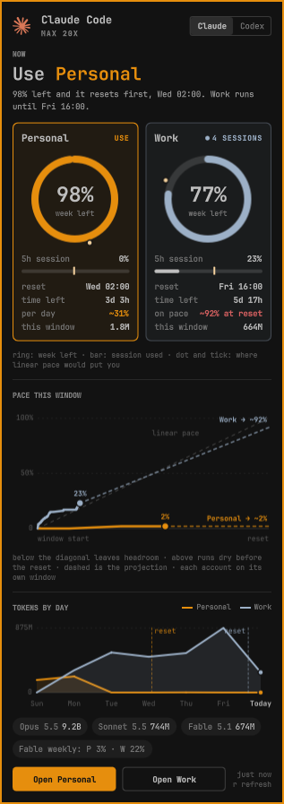

# Agent Accounts

An [Omarchy](https://omarchy.org) bar widget for people who run more than one
Claude Code account. It answers one question first: **which account should I
spend right now?**, then shows why.



Omarchy's built-in Agents widget reads a single Claude login and shows
calendar-day charts. Once you have two subscriptions (say, personal and work),
the useful numbers are different: how much of each weekly window is left, how
fast each one is burning against the time left, and which one resets first, so
its leftover allowance is not wasted.

## What it shows

- **Now**: the recommended account and one line on why ("98% left and it resets
  first, Wed 02:00. Work runs until Fri 15:59"). An account at 90% or more on any
  limit is never recommended; among the rest, the one whose weekly window resets
  first wins, then the one with more left.
- **One tile per account**:
  - a ring with the share of the week left, plus a dot where linear pace would put you;
  - the 5-hour session bar, with a tick for its own pace;
  - when the week resets and how long until then;
  - for the recommended account, how much you can spend per day; for the others,
    where current pace lands at the reset;
  - tokens spent since the window opened;
  - a badge with the open `claude` sessions on that account.
- **Pace this window**: weekly usage against elapsed window time for each account,
  with the recent trend projected to the reset. Under the diagonal leaves headroom;
  over it runs dry before the reset.
- **Tokens by day**: the current month, day 1 to its last, every account on one
  chart, with each weekly reset (past and upcoming) marked at its hour and
  weekends shaded. Hover a day for each account's tokens and any reset that day.
- **Tokens by model**: each model's tokens per account plus the total, for
  **this window**, **the last window** or **this month** (click the switch or
  press `p`). Under each account: the span it covers and, for a weekly window,
  how much of the limit it used (the last window shows the final reading the
  log took before its reset). Model-scoped weekly limits ride along as chips
  (e.g. `Fable weekly: P 3% · W 21%`).

Codex and Fireworks keep the stock Omarchy view under their own tabs.

## Install

```bash
omarchy plugin add https://github.com/cidico/omarchy-agent-accounts --enable
```

It runs fine next to the built-in `omarchy.agents` widget. Use
`omarchy plugin disable omarchy.agents` if you only want this one.

### Requirements

- Omarchy 4 (the Quickshell-based shell). The widget reuses Omarchy's own
  `omarchy-agent-usage-*` collectors for local token stats and for the other agents.
- `python3`, which Omarchy ships.
- Claude Code signed in on each account.

## Accounts

Accounts are discovered automatically: `~/.claude` plus every `~/.claude-<name>`
directory that holds a Claude Code login (`.credentials.json`). The usual way to
run a second account is a separate config dir:

```bash
alias claude-work='CLAUDE_CONFIG_DIR="$HOME/.claude-work" claude'
```

To rename or reorder them, set `accounts` on the widget's entry in
`~/.config/omarchy/shell.json`:

```json
{
  "id": "io.github.cidico.agent-accounts",
  "accounts": [
    { "id": "personal", "name": "Personal", "dir": "~/.claude" },
    { "id": "work", "name": "Work", "dir": "~/.claude-work" }
  ]
}
```

The first account also owns pi/omp/opencode sessions that ran on an Anthropic
provider, so they are not counted twice.

## Settings

| Key | Default | What it does |
|---|---|---|
| `refreshIntervalSec` | `1800` | How often the records regenerate |
| `accounts` | auto-discovered | Claude Code accounts, as shown above |
| `providers` | all enabled | `{ "codex": { "enabled": false } }` hides a provider |

## How the numbers are gathered

- **Local stats**: Omarchy's `omarchy-agent-usage-claude` runs once per account,
  pointed at a shadow config dir that links only `projects/`, `stats-cache.json`
  and `history.jsonl`. It sees no credentials, so it never makes network calls.
  Tokens per model in the current and previous weekly windows and in the month,
  and tokens per day of the month, come from one pass over the transcripts by
  timestamp, not calendar days, so a window that opens mid-day splits its day
  correctly.
- **Limits**: Anthropic's OAuth usage endpoint
  (`https://api.anthropic.com/api/oauth/usage`, the same one Omarchy's collector
  uses), queried at most once every 30 minutes per account. A failure backs off
  (60 s, doubling on HTTP 429, up to 10 minutes).
- **Shared cache**: limits are cached in `~/.cache/claude-statusline-usage-<dir>.json`
  and logged to `~/.local/state/claude-usage-<dir>.tsv`. A Claude Code status line
  can share that cache and lock (see `extras/claude-statusline.sh`), so the bar
  and the status line never both query the same account. The log also drives
  the pace projection.
- **Records**: written to `~/.local/state/io.github.cidico.agent-accounts/`.
  Scratch data goes to `~/.cache/io.github.cidico.agent-accounts/`.

## Privacy and permissions

Like every Omarchy plugin, this runs unsandboxed inside the shell with your
user's permissions. Specifically, it:

- reads the OAuth **access token** from each account's `.credentials.json`, only
  to send it in the `Authorization` header of the usage request above. It never
  writes or refreshes credentials. If a token has expired, opening that account
  in Claude Code renews it.
- reads `/proc/<pid>/comm` and `/proc/<pid>/environ` of your own processes, to
  count open `claude` sessions per account. It uses only `CLAUDECODE` and
  `CLAUDE_CONFIG_DIR` from the environment.
- sends nothing anywhere except the usage request.

## Optional: status line

`extras/claude-statusline.sh` is the author's Claude Code status line: model,
git, context, and 5h/7d/Fable meters. It shares the widget's cache, lock and
backoff. To use it, copy it to `~/.claude/` and point `statusLine` at it in each
account's `settings.json`:

```json
"statusLine": { "type": "command", "command": "~/.claude/claude-statusline.sh", "refreshInterval": 10 }
```

It needs `jq`, `curl` and `git`.

## IPC

```bash
omarchy-shell io.github.cidico.agent-accounts <open|close|toggle|refresh|next>
```

In the panel, `h`/`l` switch provider, `j`/`k` scroll, `p` cycles the model
table's period, `r` refreshes, `Esc` closes.
On the bar icon, a left click opens the panel, a right click opens the
recommended account, and a middle click moves to the next provider.

## Remove

```bash
omarchy plugin remove io.github.cidico.agent-accounts
rm -rf ~/.local/state/io.github.cidico.agent-accounts ~/.cache/io.github.cidico.agent-accounts
```

The limit cache and history (`~/.cache/claude-statusline-usage-*`,
`~/.local/state/claude-usage-*.tsv`) stay, since a status line may share them.
Delete them too if nothing else uses them.

## Credits

Built on Omarchy's `omarchy.agents` widget (MIT, © David Heinemeier Hansson).
The stock panel, discovery code, and provider marks come from there.

## License

MIT
